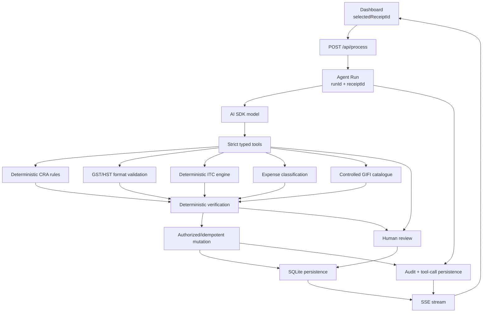

# Loopnow CPA Copilot — Architecture

## Architecture Principles

1. The LLM is a reasoning/proposal layer, not the source of truth for tax arithmetic.
2. Business rules are deterministic, versioned, and testable.
3. Tool contracts are strict and schema-validated.
4. Financial mutations are backend-authorized, transactional, and idempotent.
5. UI state, agent state, and persisted domain state have explicit ownership.
6. Technical failure and business review are separate states.
7. Tool execution and meaningful state transitions are observable and auditable.

## Runtime Flow



## State Ownership

**UI-owned:** selected receipt, message input, transient presentation state, streaming text/tool presentation, retry/error presentation.

**Agent-owned:** run ID, current stage, tool lifecycle, intermediate analysis, final verification result.

**Persisted:** receipts, classification, analysis, approvals, agent runs, tool calls, audit events, idempotency keys.

## Tool Permissions

The model receives a narrow allowlist of domain tools. There is no generic shell, code execution, filesystem, unrestricted HTTP, or generic database mutation tool.

## Deterministic Authority Boundary

The backend owns documentation thresholds, GST/HST format validation, ITC arithmetic, meal limitations, GIFI validation, transaction-type consistency, review requirements, mutation authorization, idempotency, persistence, and audit events.

## Financial Mutation Flow

```text
LLM proposal → Zod validation → run/receipt scope → deterministic verification → idempotency key → SQLite transaction → audit event
```

## Review Semantics

`REVIEW` means the workflow completed but evidence or a high-impact decision requires human attention. `ERROR` means a technical/system failure.

Receipt #003 is intentionally a review case because its documentation/GST evidence is insufficient.

## Persistence

SQLite is used for the assessment prototype. Persisted entities are receipts, agent runs, tool calls, audit events, approvals, and idempotency keys. PostgreSQL is the intended production scaling target.

## Model Abstraction

Configured through `MODEL_PROVIDER` and `MODEL_NAME`. The verified path uses `gemini` / `gemini-3.1-flash-lite`; the code also contains provider adapters for Groq and OpenRouter.

## Streaming

The processing endpoint emits token/explanation progress, tool lifecycle, state updates, final result, and error events over SSE.

## Security Boundary

Receipt/vendor text is untrusted. Controls include strict schemas, tool allowlisting, receipt/run scoping, deterministic backend authority, idempotency, human review, server-side credentials, and safe client-facing errors.

## Known Limitations

Authentication/tenant isolation, distributed rate limiting, stronger PII controls, managed PostgreSQL, OpenTelemetry tracing, and richer approval UX remain production work.
